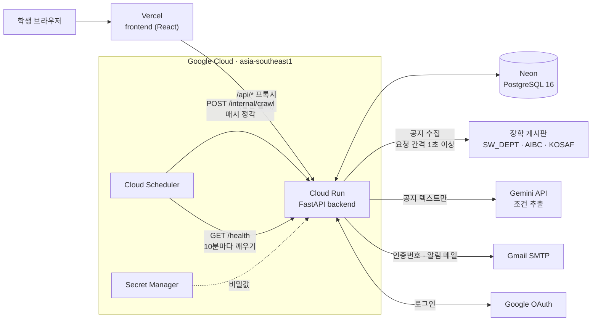
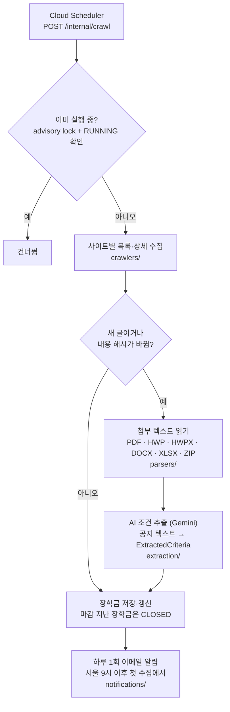
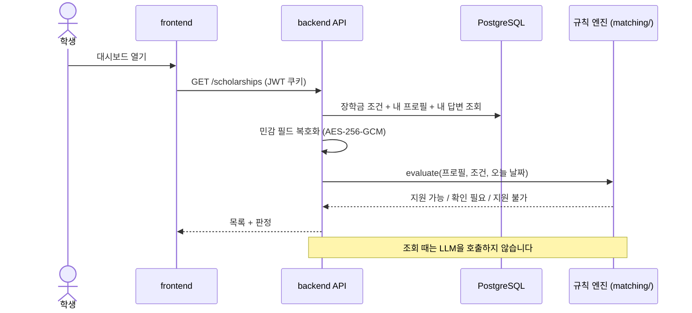
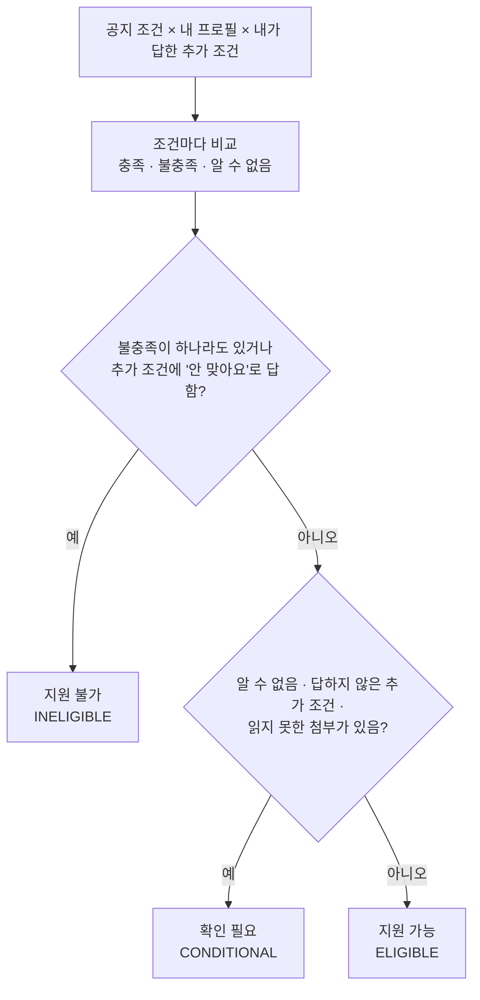
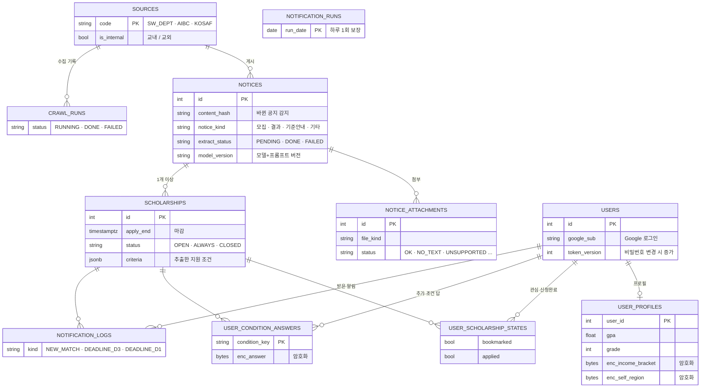
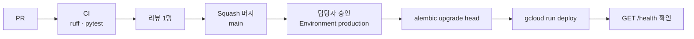

# 장학금 매칭 서비스 — Backend

학교·재단 게시판에 흩어진 **장학 공지를 자동으로 모으고**, AI(Gemini)로 지원 조건을 뽑은 뒤, 학생이 입력한 프로필과 **규칙 엔진으로 비교해** "지원 가능 / 확인 필요 / 지원 불가"를 알려 주는 서비스의 backend입니다.

| | |
| --- | --- |
| 서비스 주소 | https://cbnu-scholarship.vercel.app |
| frontend 저장소 | [WOOWANGTHON_TEAM_36_FE](https://github.com/woowangthon/WOOWANGTHON_TEAM_36_FE) |
| 사양(정답) | 상위 작업 공간의 `docs/장학금_매칭_서비스_계획서.md` |
| 작업 순서 | 상위 작업 공간의 `docs/작업카드.md` |
| 기술 스택 | Python 3.12 · FastAPI · SQLAlchemy 2 · PostgreSQL 16 (Neon) · Gemini · Cloud Run |

## 목차

1. [시스템 구성](#시스템-구성)
2. [공지가 판정이 되기까지](#공지가-판정이-되기까지)
3. [판정 규칙 엔진](#판정-규칙-엔진)
4. [개인정보 보호 원칙](#개인정보-보호-원칙)
5. [이메일 알림](#이메일-알림)
6. [데이터 모델](#데이터-모델)
7. [폴더 구조](#폴더-구조)
8. [API 목록](#api-목록)
9. [로컬에서 실행하기](#로컬에서-실행하기)
10. [테스트와 골든셋 평가](#테스트와-골든셋-평가)
11. [배포](#배포-t28)
12. [운영 가이드 (담당자용)](#운영-가이드-담당자용)

---

## 시스템 구성

학생은 Vercel에 올린 frontend만 봅니다. frontend가 `/api/*` 요청을 Cloud Run의 backend로 프록시하므로 브라우저 입장에서는 같은 출처이고, 그래서 backend에는 CORS 설정이 없습니다.



| 수집 대상 | 코드 | 구분 |
| --- | --- | --- |
| 충북대 소프트웨어학부 장학 게시판 | `SW_DEPT` | 교내 |
| 충북대 AI부트캠프사업단 공지 | `AIBC` | 교내 |
| 한국장학재단 공지 | `KOSAF` | 교외 |

---

## 공지가 판정이 되기까지

일은 **수집 시점**과 **조회 시점** 두 곳에서 일어납니다. AI는 수집 시점에만 쓰고, 학생이 화면을 열 때는 저장된 조건과 프로필을 규칙 엔진으로 비교하기만 합니다.

### 1) 수집 시점 — 매시 정각 (`POST /internal/crawl`)



- 공지의 제목·본문·첨부 목록으로 해시를 만들어, **바뀐 공지만** 다시 추출합니다.
- 추출은 한 번에 새 공지 + 대기 중인 공지 최대 20건입니다. 실패하면 `extract_status = FAILED`로 남기고 다음 공지를 계속 처리합니다(연속 3번 실패하면 더 고르지 않음).
- 한 공지에 장학금이 여러 개면 장학금 행도 여러 개가 됩니다. 재추출해도 이름이 같으면 id를 유지합니다.
- 마감일·시각은 모두 `Asia/Seoul`로 해석하고(`parsers/dates.py` 한 곳), DB에는 `timestamptz`로 저장합니다.

### 2) 조회 시점 — 학생이 대시보드를 열 때



---

## 판정 규칙 엔진

`app/matching/`은 DB·HTTP·LLM에 의존하지 않는 **순수 함수**입니다. 평점·학점·나이·소득 같은 숫자 비교는 모두 여기서 코드로 합니다(계획서 5.3).



- 공지 조건이 `null`이면 "조건 없음"이라 비교하지 않습니다.
- AI가 모호하다고 표시한 조건(`ambiguous_fields`)은 값과 관계없이 "알 수 없음"입니다.
- 프로필로 판정할 수 없는 문장형 조건(`extra_conditions`)은 학생이 직접 "맞아요 / 안 맞아요"로 답합니다.
- 읽지 못한 첨부(스캔 PDF 등)가 있으면 그 안에 조건이 있을 수 있어 "지원 가능"이라 단정하지 않습니다.
- 테스트는 계획서 5.3 표의 **조건마다 충족·불충족·알 수 없음** 세 경우를 둡니다.

---

## 개인정보 보호 원칙

| 원칙 | 구현 |
| --- | --- |
| 사용자 정보를 Gemini에 보내지 않음 | `extraction/`의 공개 함수는 `extract(request: ExtractRequest)` 하나이고 공지 텍스트만 받습니다. 사용자·프로필·인증 코드를 import하지 않는지 테스트로 검사합니다. |
| 민감 필드 암호화 | 소득분위, 본인·부모 주소, 특수자격, 추가 조건 답은 `core/crypto.py`의 AES-256-GCM으로 암호화해 저장합니다. |
| 로그 최소화 | 프로필 값·비밀번호·JWT·쿠키·토큰·키는 로그에 남기지 않고, 사용자는 `user_id`로만 기록합니다. |
| 인증 | JWT는 httpOnly·Secure·SameSite=Lax 쿠키로만 발급하고, 요청마다 `token_version`을 DB 값과 비교합니다. 비밀번호는 Argon2로 해시합니다. |
| 동의 | 개인정보 동의 전에는 프로필·장학금 API가 403을 돌려줍니다. |
| 비밀값 | `.env`는 커밋하지 않고, 배포 환경은 Secret Manager를 씁니다. |

---

## 이메일 알림

수집이 끝난 뒤 같은 요청 안에서 `run_daily_notifications()`를 부릅니다. 서울 9시 이후이고 오늘 아직 보내지 않았을 때만 발송하며, 알림이 실패해도 수집은 성공으로 응답합니다.

| 종류 | 대상 |
| --- | --- |
| `NEW_MATCH` | 최근 48시간 안에 새로 올라온 모집 중 장학금 중 판정이 "지원 불가"가 아닌 것 |
| `DEADLINE_D3`, `DEADLINE_D1` | 관심 표시한 모집 중 장학금의 마감 3일 전·1일 전. 마감이 연장되면 다시 알림 |

- 신청완료로 표시한 장학금은 알리지 않습니다.
- 메일에는 장학금 이름·마감·판정 표시·링크만 넣고, **판정 근거나 프로필 값은 넣지 않습니다.**
- 보낸 항목은 `notification_logs`에 남기고, 실패한 사용자는 기록하지 않아 다음 날 다시 시도됩니다.

---

## 데이터 모델



스키마 변경은 Alembic 마이그레이션(`alembic/versions/`)으로만 합니다.

---

## 폴더 구조

```
app/
├─ main.py         # FastAPI 앱 진입점 (시작 시 DB 연결하지 않음)
├─ core/           # config, db, crypto(AES-GCM), security(Argon2·JWT·시도 제한), mail, logging
├─ models/         # SQLAlchemy 모델
├─ schemas/        # API 요청·응답 DTO
├─ crawlers/       # base.py(요청 간격·User-Agent·타임아웃), sw_dept.py, aibc.py, kosaf.py
├─ parsers/        # pdf, hwp, attachments(HWPX·DOCX·XLSX·ZIP), deadline, dates(서울 시간 해석)
├─ extraction/     # schemas.py(ExtractedCriteria), extractor.py(Gemini 호출·재시도), prompts/extract_vN.md
├─ matching/       # rules.py(조건별 비교), engine.py(3단계 판정), describe.py(화면 문구)
├─ scheduler/      # jobs.py — 수집 작업
├─ notifications/  # select.py(대상 선정), message.py(메일 내용), jobs.py(하루 1회 발송)
└─ api/            # health, auth, google, profile, scholarships, notifications, admin, internal
alembic/           # DB 마이그레이션
eval/              # 골든셋 평가 (run.py, scoring.py, results/)
scripts/           # check_sites.py — 배포 리전에서 사이트 접근 확인
tests/             # pytest. fixtures/에 저장 HTML·첨부·골든셋(공지 31건 + 정답)
```

---

## API 목록

전체 명세는 서버 실행 후 http://localhost:8000/docs 에서 볼 수 있습니다. frontend는 `/openapi.json`에서 `npm run gen:api`로 타입을 생성하므로, API를 바꾸면 frontend PR도 함께 만듭니다.

| 분류 | 메서드 · 경로 | 설명 |
| --- | --- | --- |
| 상태 | `GET /health` | 헬스 체크 |
| 회원 | `POST /auth/signup/code` · `/signup/verify` · `/signup` | 이메일 인증번호 발송·확인, 가입 |
| | `POST /auth/login` · `/logout` | 로그인·로그아웃 (쿠키) |
| | `GET /auth/google/login` · `/callback` | Google 로그인 |
| | `POST /auth/consent` · `DELETE /auth/consent/sensitive` | 개인정보·민감정보 동의, 민감정보 동의 철회 |
| | `GET /auth/me` · `DELETE /auth/me` | 내 계정 조회·탈퇴 |
| | `PUT /auth/me/notifications` · `/me/password` | 메일 알림 설정, 비밀번호 변경 |
| 프로필 | `GET /profile` · `PUT /profile` | 내 정보 조회·저장 |
| 장학금 | `GET /scholarships` | 목록 + 판정 (대시보드) |
| | `GET /scholarships/{id}` | 상세 + 조건별 체크리스트 |
| | `PUT /scholarships/{id}/state` | 관심·신청완료 표시 |
| | `PUT` · `DELETE /scholarships/{id}/conditions/{key}` | 추가 조건 답하기·지우기 |
| 알림 | `POST /notifications/unsubscribe` | 메일 링크로 수신 거부 |
| 관리자 | `GET /admin/crawl-runs` | 수집 기록 |
| | `POST /admin/notices/{id}/reextract` | 재추출 예약 (다음 수집에서 처리) |
| 내부 | `POST /internal/crawl` | 정기 수집 + 알림 (`X-Cron-Token` 필요) |

---

## 로컬에서 실행하기

필요한 도구: [uv](https://docs.astral.sh/uv/), Docker. 로컬에서는 `AI_MOCK=1`, `MAIL_MOCK=1`이라 Gemini 키나 메일 계정 없이 돌아갑니다(가입 인증번호는 `000000`).

```bash
cp .env.example .env              # 값은 로컬 기본값 그대로 써도 됨
uv sync                           # 의존성 설치

# 방법 1: postgres + backend를 컨테이너로
docker compose up -d postgres
uv run alembic upgrade head       # 테이블 생성
docker compose up backend         # http://localhost:8000/docs

# 방법 2: postgres만 컨테이너로, backend는 직접 실행
docker compose up -d postgres
uv run alembic upgrade head
uv run uvicorn app.main:app --port 8000 --reload
```

frontend까지 함께 띄우려면 두 저장소를 `backend/`, `frontend/`로 나란히 clone한 뒤 `docker compose --profile full up`을 씁니다(frontend는 http://localhost:5173).

### 자주 쓰는 명령

| 하는 일 | 명령 |
| --- | --- |
| 테스트 | `uv run pytest` |
| 린트·포맷 | `uv run ruff check . && uv run ruff format .` |
| 마이그레이션 만들기 | `uv run alembic revision --autogenerate -m "..."` |
| 마이그레이션 적용 | `uv run alembic upgrade head` |
| 수집 1회 실행 | `uv run python -m app.scheduler.jobs` |
| 사이트 하나만 / 1년치 백필 | `--source SW_DEPT` / `--backfill` |
| 첨부 다시 읽기 | `uv run python -m app.scheduler.jobs --reread-attachments` |
| 알림 발송 | `uv run python -m app.notifications.jobs` (`--force`: 9시·오늘 실행 여부 무시) |
| 골든셋 평가 (실제 Gemini 호출) | `uv run python -m eval.run` |

### 환경변수

`.env.example`에 이름과 설명이 있습니다. `.env`는 커밋하지 않습니다.

| 변수 | 용도 |
| --- | --- |
| `DATABASE_URL`, `DATABASE_URL_DIRECT` | 앱용(pooled)·마이그레이션용(direct) DB 주소. 드라이버는 `postgresql+psycopg://` |
| `JWT_SECRET`, `FIELD_ENCRYPTION_KEY` | 로그인 토큰 서명, 민감 필드 암호화 키(32바이트 base64) |
| `GEMINI_API_KEY`, `GEMINI_MODEL` | AI 추출. 모델 이름은 코드에 박지 않고 여기서 읽음(현재 `gemini-4-hydrogen`) |
| `AI_MOCK`, `MAIL_MOCK` | 로컬 전용. 1이면 Gemini·메일 대신 목 사용 |
| `CRON_TOKEN` | `/internal/crawl` 호출 토큰 |
| `GOOGLE_CLIENT_ID`, `GOOGLE_CLIENT_SECRET`, `GOOGLE_REDIRECT_URI` | Google 로그인 |
| `ADMIN_EMAILS` | 관리자 이메일(쉼표 구분, Google 로그인 계정이어야 함) |
| `SMTP_USER`, `SMTP_PASSWORD` | Gmail 주소와 앱 비밀번호 |
| `APP_BASE_URL` | 알림 메일 속 링크의 기준 주소 |

---

## 테스트와 골든셋 평가

- **테스트**(`uv run pytest`)는 네트워크에 나가지 않습니다. 크롤러·파서는 `tests/fixtures/`의 저장 HTML·첨부로, 추출은 Gemini 클라이언트를 목으로 바꿔 검사합니다. DB 테스트는 `TEST_DATABASE_URL`이 없으면 건너뜁니다.
- 테스트는 `.env`와 셸 환경변수를 읽지 않습니다. 설정값이 필요하면 `monkeypatch.setenv`로 넣습니다.
- **골든셋 평가**(`uv run python -m eval.run`)는 사람이 정답을 단 공지 31건으로 추출 정확도를 잽니다. 결과는 `eval/results/{모델}+{프롬프트 버전}.json`에 저장하고 커밋합니다. 목표는 90%입니다.

| 모델 + 프롬프트 | 평가일 | 정답률 |
| --- | --- | --- |
| `gemini-4-hydrogen+extract_v15` | 2026-11-14 | 166 / 166 (100%) |

프롬프트를 크게 바꿀 때는 `app/extraction/prompts/`에 새 버전 파일(`extract_vN.md`)을 만들고 다시 평가합니다.

---

## 개발 규칙

- 브랜치·커밋·PR 규칙은 [CONTRIBUTING.md](CONTRIBUTING.md)를 따릅니다. `main`에 직접 push하지 않고, 카드 하나마다 PR 하나를 만들어 Squash 머지합니다.
- 코드 작성 규칙(크롤러, 추출, 인증, 지연 대책 등)은 [CLAUDE.md](CLAUDE.md)에 있습니다.
- 문서·주석·커밋 메시지는 한국어, 코드 식별자는 영어로 씁니다.

---

## 배포 (T28)

`main`에 머지하면 GitHub Actions(`.github/workflows/deploy.yml`)가 backend를 Cloud Run에 배포합니다(계획서 9.5, 9.7).



- 순서: 담당자 승인(GitHub Environment `production`) → 마이그레이션(`DATABASE_URL_DIRECT`) → `gcloud run deploy --source .` → `GET /health` 확인
- 인증: Workload Identity Federation. 서비스 계정 키는 만들지 않습니다.
- 서비스: `scholarship-backend` (`asia-southeast1`), 런타임 서비스 계정 `scholarship-backend@`(Secret Manager 읽기만)
- 비밀값은 Secret Manager에서 연결하고, 비밀이 아닌 값(`GEMINI_MODEL`, `GOOGLE_REDIRECT_URI`, `APP_BASE_URL`)은 워크플로에 적고, `GOOGLE_CLIENT_ID`·`ADMIN_EMAILS`는 Environment 변수로 둡니다.
- 소스 업로드에서 빼는 파일은 `.gcloudignore`에 있습니다(`.env` 포함).

---

## 운영 가이드 (담당자용)

계정 생성·결제·비밀값 입력·권한 설정처럼 **처음 한 번만** 하는 일입니다. 개발 담당자가 직접 하며, 평소 개발에는 필요하지 않습니다.

<details>
<summary><b>배포 준비 (T08)</b> — Google Cloud·Neon·Gemini·OAuth·Vercel·Secret Manager</summary>

계정 생성, 결제, 비밀값 입력은 **개발 담당자**가 직접 합니다. 아래 순서대로 체크하고, 확인한 값(리전, 모델 이름, 한도)은 계획서에 기록합니다.

공통 변수(명령 예시에서 씀):

```bash
export PROJECT_ID=<프로젝트 ID>
export REGION=asia-southeast1   # 싱가포르 (9.1). 사이트가 막히면 asia-northeast3(서울)
```

#### 1. Google Cloud 결제·프로젝트 (9.1)

- [ ] 담당자 Google 계정으로 결제 계정 생성(무료 체험, 2027-02-02까지)
- [ ] 프로젝트 생성 후 `gcloud config set project $PROJECT_ID`
- [ ] 예산 알림 월 $5: Billing → Budgets & alerts. **"Include credits in cost" 체크 해제**(크레딧 제외 기준), 알림 수신자는 담당자만(결제 관리자·사용자 기본 알림 해제 후 담당자 이메일만)
- [ ] IAM에서 다른 팀원에게 프로젝트 편집 이상 권한을 주지 않음
- [ ] API 사용 설정

  ```bash
  gcloud services enable run.googleapis.com cloudbuild.googleapis.com \
    artifactregistry.googleapis.com secretmanager.googleapis.com \
    cloudscheduler.googleapis.com
  ```

#### 2. 사이트 접근 확인: Cloud Run Job (완료 기준)

`scripts/check_sites.py`는 표준 라이브러리만 씁니다. 그래서 앱 이미지를 빌드하지 않고 공개 `python:3.12-slim` 이미지에 스크립트를 base64로 넘겨 실행합니다. gcloud `--args`는 쉼표로 인자를 나누는데, base64에는 쉼표가 없어서 안전합니다.

```bash
SCRIPT_B64=$(base64 < scripts/check_sites.py | tr -d '\n')
gcloud run jobs deploy check-sites \
  --region $REGION \
  --image mirror.gcr.io/library/python:3.12-slim \
  --command sh \
  --args="-c","echo $SCRIPT_B64 | base64 -d | python -" \
  --max-retries 0 --task-timeout 120s
gcloud run jobs execute check-sites --region $REGION --wait
```

결과는 Cloud Logging에서 확인합니다.

```bash
gcloud logging read 'resource.type="cloud_run_job" AND resource.labels.job_name="check-sites"' \
  --limit 20 --format 'value(textPayload)' --freshness 10m
```

- [ ] 세 사이트(SW_DEPT, AIBC, KOSAF) 모두 `200`이면 싱가포르 확정
- [ ] 하나라도 막히면 `REGION=asia-northeast3`으로 다시 실행하고, 결과를 계획서 9.1 "리전"에 기록
- [ ] 확인이 끝나면 Job 삭제: `gcloud run jobs delete check-sites --region $REGION`

#### 3. Neon (9.4)

- [ ] 프로젝트 생성: PostgreSQL **16**, 리전 **AWS Asia Pacific (Singapore)**
- [ ] Compute 설정: 오토스케일 최대 **0.25 CU**(최소도 0.25)
- [ ] 연결 문자열 두 개를 복사해 드라이버를 `postgresql+psycopg://`로 바꿈
  - pooled(호스트에 `-pooler`) → `DATABASE_URL`
  - direct → `DATABASE_URL_DIRECT`
- [ ] 매월 15일 전후 사용량 확인 일정 등록(100 CU-시간 초과 시 DB 정지)

#### 4. Gemini (3장 AI 행, 9.1, 9.6, 9.9)

GCP 무료 체험 크레딧은 Gemini에 쓸 수 없습니다(2026-03부터). AI Studio 선불 크레딧으로 결제합니다.

- [ ] AI Studio에서 이 GCP 프로젝트를 가져옴(Import project)
- [ ] AI Studio 결제 화면에서 **선불 크레딧 $5** 구매(자동 충전 끔). 잔액이 $0이면 호출이 402로 실패함
- [ ] API 키를 gcloud로 만들고 Gemini API만 쓰도록 제한한 뒤, 값을 화면에 띄우지 않고 Secret Manager에 바로 등록

  ```bash
  gcloud services enable generativelanguage.googleapis.com apikeys.googleapis.com
  gcloud services api-keys create --display-name=scholarship-gemini \
    --api-target=service=generativelanguage.googleapis.com --format='value(name)'
  gcloud services api-keys get-key-string <위 출력의 키 이름> --format='value(keyString)' \
    | tr -d '\n' | gcloud secrets create GEMINI_API_KEY --replication-policy=automatic --data-file=-
  ```

- [ ] 새 프로젝트에서 쓸 수 있는 모델 이름을 확인해 계획서 9.6 `GEMINI_MODEL` 칸과 `deploy.yml`에 기록(2026-11-05 T08: `gemini-3.8-flash`, 2026-11-13 T47: `gemini-4-hydrogen`)
- [ ] AI Studio 한도 화면의 **분당·하루 요청 한도**를 계획서 9.9에 기록(2026-11-05 Tier 1: RPM 1,000 / TPM 2M / RPD 10,000)

**키·계정 교체** (2026-11-13 T47부터 다른 사람 계정의 키를 씀, 계획서 9.1)

- [ ] 키 소유자가 자기 AI Studio 프로젝트에서 **유료 등급** 키를 발급하고, 모델 사용 가능 여부와 한도를 확인
- [ ] 담당자가 아래 명령을 먼저 실행한 뒤 입력 프롬프트에 키를 붙여 넣고 Enter. `create`가 아니라 `versions add`라서 Cloud Run 서비스 계정의 읽기 권한이 그대로 유지됨

  ```bash
  read -rs k && printf %s "$k" | gcloud secrets versions add GEMINI_API_KEY \
    --project=scholarship-matcher-513804 --data-file=- ; unset k
  ```

- [ ] 실행 중인 인스턴스는 이전 키를 계속 쓰므로 새 revision을 띄움(`deploy` 워크플로 수동 실행, 또는 아래 명령)

  ```bash
  gcloud run services update scholarship-backend --region asia-southeast1 \
    --project scholarship-matcher-513804 --update-secrets GEMINI_API_KEY=GEMINI_API_KEY:latest
  ```

- [ ] 다음 수집에서 추출이 `FAILED`로 남지 않는지 확인한 뒤, 이전 버전을 사용 중지(`gcloud secrets versions disable <이전 버전> --secret=GEMINI_API_KEY`)하고 이전 계정의 키를 삭제

#### 5. Google OAuth (7.3 표)

- [ ] OAuth 동의 화면: 사용자 유형 **External**, scope는 `openid email profile`만
- [ ] 앱 홈페이지·개인정보처리방침 링크: `https://cbnu-scholarship.vercel.app/`, `https://cbnu-scholarship.vercel.app/privacy`
- [ ] OAuth 클라이언트: 유형 **웹 애플리케이션**, 승인된 리디렉션 URI 2개
  - `https://cbnu-scholarship.vercel.app/api/auth/google/callback`
  - `http://localhost:5173/api/auth/google/callback`
- [ ] `GOOGLE_CLIENT_ID`, `GOOGLE_CLIENT_SECRET` 보관(secret은 7번 Secret Manager에만)
- [ ] `/privacy` 화면 배포(T24) 후 게시 상태를 **Testing → In production**으로 전환

#### 6. Vercel (9.2, 9.7)

- [ ] Hobby 계정으로 공개 저장소 `WOOWANGTHON_TEAM_36_FE`를 Import(Framework: Vite, 프로젝트 이름 `scholarship-matcher`)
- [ ] 프로덕션 주소 확정 → 5번 OAuth 설정에 입력. 2026-11-06: `https://cbnu-scholarship.vercel.app`(프로젝트 → Settings → Domains에서 추가. 기본 주소 `scholarship-matcher-seven.vercel.app`도 그대로 동작)
- [ ] `vercel.json`의 backend 주소는 첫 backend 배포(T28) 후 실제 `run.app` 주소로 바꿈

#### 7. Secret Manager (9.5)

비밀값 7개를 등록합니다. `GEMINI_API_KEY`는 4번에서 이미 등록했습니다. 값이 화면·셸 기록에 남지 않도록 명령을 먼저 실행하고, 입력 프롬프트에 붙여 넣은 뒤 Enter를 누릅니다(입력은 보이지 않음). 명령을 복사하면 클립보드의 비밀값이 덮어써지므로 비밀값은 명령 실행 **뒤에** 복사합니다.

```bash
# zsh 기준. 이름마다 한 번씩 실행
name=GOOGLE_CLIENT_SECRET   # DATABASE_URL, DATABASE_URL_DIRECT도 같은 방법
read -rs "v?$name: "; echo
printf %s "$v" | gcloud secrets create $name --replication-policy=automatic --data-file=-
unset v
```

값을 붙여 넣는 칸이 프롬프트가 아니라 명령줄이면 셸이 그 값을 명령으로 실행해 기록에 남습니다. 그랬다면 그 값은 새로 발급합니다.

무작위 값 3개는 생성해서 바로 등록합니다(화면에 출력하지 않음).

```bash
python3 -c "import secrets; print(secrets.token_urlsafe(48), end='')" \
  | gcloud secrets create JWT_SECRET --replication-policy=automatic --data-file=-
python3 -c "import secrets; print(secrets.token_urlsafe(32), end='')" \
  | gcloud secrets create CRON_TOKEN --replication-policy=automatic --data-file=-
# AES-256 키: 32바이트 무작위 값의 base64 (T18 core/crypto.py가 이 형식을 읽음)
python3 -c "import base64, secrets; print(base64.b64encode(secrets.token_bytes(32)).decode(), end='')" \
  | gcloud secrets create FIELD_ENCRYPTION_KEY --replication-policy=automatic --data-file=-
```

- [ ] 7개 등록 확인: `gcloud secrets list`
- [ ] `FIELD_ENCRYPTION_KEY`는 잃어버리면 암호화 필드를 복구할 수 없으므로 담당자만 아는 곳에 따로 백업
- [ ] 값을 바꾸면 `gcloud secrets versions add`로 새 버전을 넣고, 이전 버전은 `versions disable` 후 확인되면 `versions destroy`(무료 활성 버전 6개)

비밀이 아닌 값(`GEMINI_MODEL`, `GOOGLE_CLIENT_ID`, `GOOGLE_REDIRECT_URI`, `ADMIN_EMAILS`, `APP_BASE_URL`)은 Cloud Run 환경변수로 직접 넣습니다(T28).

</details>

<details>
<summary><b>배포 최초 설정 (T28)</b> — IAM 권한·GitHub Environment·공개 접근·Scheduler</summary>

#### 최초 1회: 권한 설정 (담당자)

필요한 역할은 공식 문서(Cloud Run 소스 배포의 Required roles, 2026-11-06 확인)를 따릅니다. 계획서 9.7 목록도 이에 맞춰 고쳤습니다.

```bash
export PROJECT_ID=scholarship-matcher-513804 REGION=asia-southeast1
export PROJECT_NUMBER=$(gcloud projects describe $PROJECT_ID --format='value(projectNumber)')
export REPO=woowangthon/WOOWANGTHON_TEAM_36_BE
export RUNTIME_SA=scholarship-backend@$PROJECT_ID.iam.gserviceaccount.com
export DEPLOY_SA=github-deploy@$PROJECT_ID.iam.gserviceaccount.com

# 1) 런타임 서비스 계정: 앱이 쓰는 비밀값 6개만 읽기
gcloud iam service-accounts create scholarship-backend --display-name="backend runtime"
for s in DATABASE_URL JWT_SECRET FIELD_ENCRYPTION_KEY GEMINI_API_KEY CRON_TOKEN GOOGLE_CLIENT_SECRET; do
  gcloud secrets add-iam-policy-binding $s --member=serviceAccount:$RUNTIME_SA \
    --role=roles/secretmanager.secretAccessor --condition=None
done

# 2) 빌드 서비스 계정(Compute Engine 기본): 소스 배포 빌드
gcloud projects add-iam-policy-binding $PROJECT_ID \
  --member=serviceAccount:$PROJECT_NUMBER-compute@developer.gserviceaccount.com \
  --role=roles/run.builder --condition=None

# 3) 배포용 서비스 계정 (GitHub Actions가 빌려 씀)
gcloud iam service-accounts create github-deploy --display-name="GitHub Actions deploy"
for r in roles/run.sourceDeveloper roles/serviceusage.serviceUsageConsumer; do
  gcloud projects add-iam-policy-binding $PROJECT_ID --member=serviceAccount:$DEPLOY_SA \
    --role=$r --condition=None
done
gcloud iam service-accounts add-iam-policy-binding $RUNTIME_SA \
  --member=serviceAccount:$DEPLOY_SA --role=roles/iam.serviceAccountUser
# 빌드 계정도 빌려 써야 합니다. 없으면 빌드가 PERMISSION_DENIED로 실패합니다(2026-11-06 첫 배포에서 확인).
gcloud iam service-accounts add-iam-policy-binding $PROJECT_NUMBER-compute@developer.gserviceaccount.com \
  --member=serviceAccount:$DEPLOY_SA --role=roles/iam.serviceAccountUser
gcloud secrets add-iam-policy-binding DATABASE_URL_DIRECT --member=serviceAccount:$DEPLOY_SA \
  --role=roles/secretmanager.secretAccessor --condition=None   # 마이그레이션용

# 4) Workload Identity Federation: 이 저장소의 Actions만 배포 계정을 빌릴 수 있음
gcloud iam workload-identity-pools create github --location=global --display-name="GitHub Actions"
gcloud iam workload-identity-pools providers create-oidc backend-repo \
  --location=global --workload-identity-pool=github --display-name="backend repo" \
  --issuer-uri=https://token.actions.githubusercontent.com \
  --attribute-mapping="google.subject=assertion.sub,attribute.repository=assertion.repository,attribute.ref=assertion.ref" \
  --attribute-condition="assertion.repository == '$REPO'"
gcloud iam service-accounts add-iam-policy-binding $DEPLOY_SA --role=roles/iam.workloadIdentityUser \
  --member="principalSet://iam.googleapis.com/projects/$PROJECT_NUMBER/locations/global/workloadIdentityPools/github/attribute.repository/$REPO"
```

#### 최초 1회: GitHub 설정 (담당자)

```bash
REPO=woowangthon/WOOWANGTHON_TEAM_36_BE
# Environment production: 필수 승인자 = 담당자(GitHub 사용자 id), main 브랜치만 배포
gh api -X PUT repos/$REPO/environments/production \
  -F "reviewers[][type]=User" -F "reviewers[][id]=$(gh api user -q .id)" \
  -F "deployment_branch_policy[protected_branches]=false" \
  -F "deployment_branch_policy[custom_branch_policies]=true"
gh api -X POST repos/$REPO/environments/production/deployment-branch-policies -f name=main -f type=branch

# Environment 변수 (비밀값 아님)
gh variable set GCP_WIF_PROVIDER --env production --repo $REPO \
  --body "projects/$PROJECT_NUMBER/locations/global/workloadIdentityPools/github/providers/backend-repo"
gh variable set GCP_DEPLOY_SA --env production --repo $REPO --body "$DEPLOY_SA"
gh variable set GOOGLE_CLIENT_ID --env production --repo $REPO --body "<OAuth 클라이언트 ID>"
gh variable set ADMIN_EMAILS --env production --repo $REPO --body "<관리자 Gmail, 쉼표 구분>"
```

#### 최초 1회: 첫 배포 후 공개 접근·정리 정책·Scheduler

배포용 계정에는 IAM 정책 변경 권한이 없으므로 공개 접근(`allUsers` 호출 허용)은 첫 배포 직후 프로젝트 소유자가 한 번 설정합니다. 그 전까지는 워크플로의 `/health` 확인이 403으로 실패하는 것이 정상입니다.

```bash
gcloud run services add-iam-policy-binding scholarship-backend --region=$REGION \
  --member=allUsers --role=roles/run.invoker
URL=$(gcloud run services describe scholarship-backend --region=$REGION --format='value(status.url)')

# Artifact Registry: 최근 이미지 2개만 남김(1개는 롤백용, 9.5)
cat > /tmp/ar-cleanup.json <<'JSON'
[
  {"name": "keep-2-most-recent", "action": {"type": "Keep"}, "mostRecentVersions": {"keepCount": 2}},
  {"name": "delete-others", "action": {"type": "Delete"}, "condition": {"tagState": "ANY"}}
]
JSON
gcloud artifacts repositories set-cleanup-policies cloud-run-source-deploy \
  --location=$REGION --policy=/tmp/ar-cleanup.json --no-dry-run

# 소스 버킷: 30일 지난 파일 삭제(9.5)
echo '{"rule":[{"action":{"type":"Delete"},"condition":{"age":30}}]}' > /tmp/lifecycle.json
gcloud storage buckets update gs://run-sources-$PROJECT_ID-$REGION --lifecycle-file=/tmp/lifecycle.json

# Cloud Scheduler 2개 (9.3, 9.8). 토큰은 화면에 출력하지 않고 바로 넘깁니다.
gcloud scheduler jobs create http crawl --location=$REGION \
  --schedule="0 0,3,6-23 * * *" --time-zone=Asia/Seoul \
  --uri="$URL/internal/crawl" --http-method=POST \
  --headers="X-Cron-Token=$(gcloud secrets versions access latest --secret=CRON_TOKEN)" \
  --attempt-deadline=30m --max-retry-attempts=0
gcloud scheduler jobs create http wake --location=$REGION \
  --schedule="*/10 8-23 * * *" --time-zone=Asia/Seoul \
  --uri="$URL/health" --http-method=GET --attempt-deadline=30s --max-retry-attempts=0
```

- 확인: `gcloud scheduler jobs run crawl --location=$REGION` 후 Neon `crawl_runs`에 `DONE` 기록 (첫 실행은 공지 32건 추출에 약 8분)
- `CRON_TOKEN`을 바꾸면 `gcloud scheduler jobs update http crawl --update-headers=...`로 같이 바꿉니다.
- 백필(T29) 동안은 `gcloud scheduler jobs pause crawl`, 끝나면 `resume`

</details>
